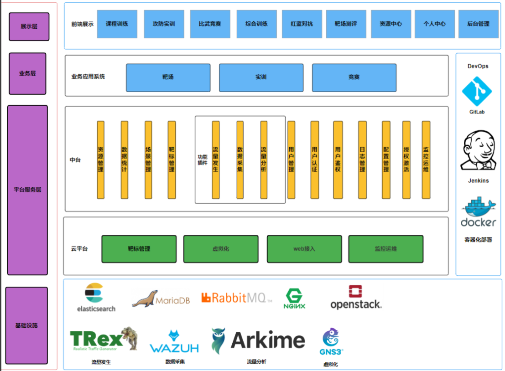
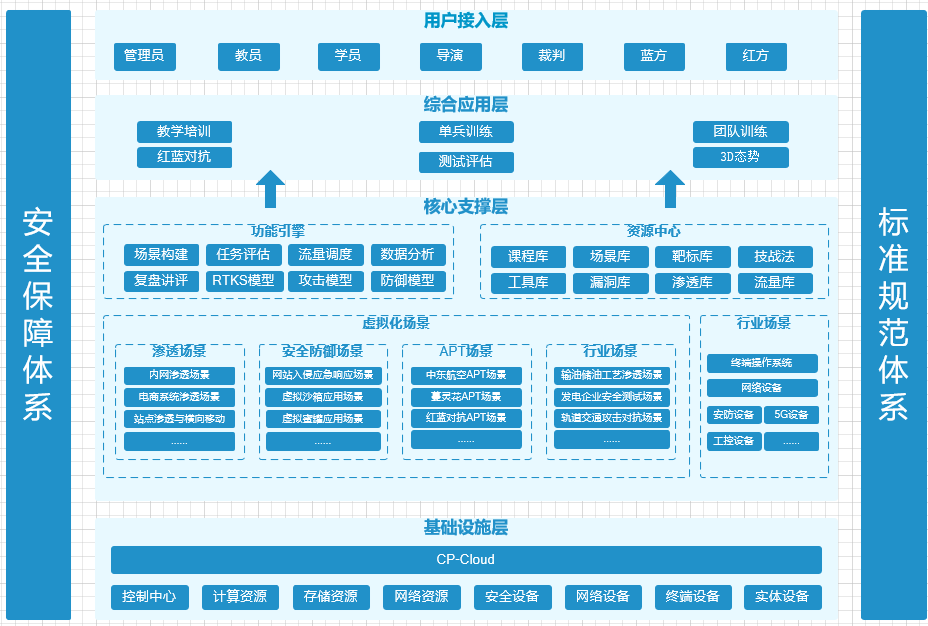

# 项目描述
网络靶场项目支持场景仿真、流量与行为仿真、数据采集与分析、任务方案管理以及红蓝对抗训练。系统支持通过拖拽构建网络拓扑，设置链路和拓扑区域属性，编辑节点信息，以及导入导出场景数据。它还允许用户进行流量仿真，包括背景流量和攻击流量的注入，以及实时解析和注入。此外，系统能够采集各种网络数据，包括主机信息、变更事件和日志，提供协议解析和自定义探针管理。通过这个平台，用户可以进行团队训练、红蓝对抗演练，并进行能力测评，全面提升网络安全技能。

# 项目基本结构

- 项目结构
```
├─common                                     # 公共模块
│  ├─src
│    ├─main
│      └─java
│          └─com
│              └─cyberpeace
│                  ├─common                  # 公共类
│                  └─constant                # 公共常亮
├─common-service  公共服务模块
│  ├─src
│    └─main
│        ├─java
│        │  └─com
│        │      └─cyberpeace
│        │          └─cs
│        └─resources
│            └─mapper
│                └─cr
├─cr
│  ├─cr_base                                 # 场景基础功能模块
│  │  ├─src
│  │    └─main
│  │        ├─java
│  │        │  └─com
│  │        │      └─cyberpeace
│  │        │          └─cr
│  │        │              └─crbase
│  │        └─resources
│  │            └─mapper
│  │                └─cr
│  ├─evaluation                              #  能力测试模块
│  │  ├─src
│  │    └─main
│  │        ├─java
│  │        │  └─com
│  │        │      └─cyberpeace
│  │        │          └─cr
│  │        │              └─evaluation
│  │        └─resources
│  │            └─mapper
│  │                └─cr
│  ├─red_vs_blue                             # 红蓝对抗模块
│  │  ├─src
│  │    └─main
│  │        ├─java
│  │        │  └─com
│  │        │      └─cyberpeace
│  │        │          └─cr
│  │        │              └─redvsblue
│  │        └─resources
│  │            └─mapper
│  │                └─cr
│  ├─single_train                            # 单兵训练模块
│  │  ├─src
│  │    └─main
│  │        ├─java
│  │        │  └─com
│  │        │      └─cyberpeace
│  │        │          └─cr
│  │        │              └─singletrain
│  │        └─resources
│  │            └─mapper
│  │                └─cr
│  ├─team_train                              # 团队训练模块
│  │  ├─src
│  │    └─main
│  │        ├─java
│  │        │  └─com
│  │        │      └─cyberpeace
│  │        │          └─cr
│  │        │              └─teamtrain
│  │        └─resources
│  │            └─mapper
│  │                └─cr
│  └─tool                                    # 工具资源模块
│      ├─src
│        └─main
│            ├─java
│            │  └─com
│            │      └─cyberpeace
│            │          └─cr
│            │              └─tool
│            └─resources
│                └─mapper
│                    └─cr
├─docs                                      # 文档模块
├─gateway                                   # 提供外部调用模块
│  ├─src
│    ├─main
│      ├─java
│      │  └─com
│      │      └─cyberpeace
│      │          └─gateway
│      └─resources
├─integration                                # 调用外部服务模块
│  ├─src
│    ├─main
│      └─java
│          └─com
│              └─cyberpeace
│                  └─integratation
├─oj                                         # 课程、练习模块
│  ├─course
│  │  ├─src
│  │    └─main
│  │        ├─java
│  │        │  └─com
│  │        │      └─cyberpeace
│  │        │          └─oj
│  │        │              └─course
│  │        └─resources
│  │            └─mapper
│  │                └─oj
│  ├─oj_base                                 # 实训基础模块
│  │  ├─src
│  │    └─main
│  │        ├─java
│  │        │  └─com
│  │        │      └─cyberpeace
│  │        │          └─oj
│  │        │              └─ojbase
│  │        └─resources
│  │            └─mapper
│  │                └─oj
│  ├─person                                  # 个人中心模块
│  │  ├─src
│  │    └─main
│  │        ├─java
│  │        │  └─com
│  │        │      └─cyberpeace
│  │        │          └─oj
│  │        │              └─person
│  │        └─resources
│  │            └─mapper
│  │                └─oj
│  └─practice                                # 练习模块
│      ├─src
│        └─main
│            ├─java
│            │  └─com
│            │      └─cyberpeace
│            │          └─oj
│            │              └─practice
│            └─resources
│                └─mapper
│                    └─oj
├─rtks                                        # 训练技能模块
│  ├─src
│    ├─main
│      ├─java
│      │  └─com
│      │      └─cyberpeace
│      │          └─rtks
│      └─resources
│          └─mapper
│              └─rtks
├─situation                                   # 3D态势模块
│  ├─src
│    └─main
│        ├─java
│        │  └─com
│        │      └─cyberpeace
│        │          └─situation
│        └─resources
│            └─mapper
│                └─situation
└─template                                   # 主模块
    ├─src
      ├─main
        ├─java
        │  └─com
        │      └─cyberpeace
        │          ├─config                  # 配置文件
        │          │  ├─aop                  # AOP配置
        │          │  ├─aspects              # 切面配置
        │          │  ├─async                # 异步配置
        │          │  ├─auth                 # 认证配置
        │          │  ├─custom               # 自定义配置
        │          │  ├─db                   # 数据库配置
        │          │  ├─filter               # 过滤器配置
        │          │  ├─interceptors         # 拦截器配置
        │          │  ├─log4j                # 日志配置
        │          │  ├─mq                   # 消息队列配置
        │          │  ├─schedule             # 定时任务配置
        │          │  ├─swagger              # swagger配置
        │          │  ├─validation           # 验证配置
        │          │  └─ws                   # websocket配置
        │          └─job                     # 定时任务
        └─resources
            ├─env                            # 环境配置           
            │  ├─dev                         # 开发环境配置
            │  │  ├─db
            │  │  └─modules
            │  ├─prod                        # 生产环境配置
            │  │  ├─db
            │  │  └─modules
            │  └─test                        # 测试环境配置
            │      ├─db
            │      └─modules
            ├─modules                        # 模块配置
            └─static                         # 静态文件
                ├─sql                        # sql文件
                │  ├─bc                      # 靶场数据
                │  ├─data_en-us              # 英文sql
                │  └─data_zh-cn              # 中文sql
                └─template                   # 模板文件
                    └─html_to_pdf_template   # html转pdf
```
- 应用入口
> com.cyberpeace.OJApplication.main

# 项目架构
- 技术架构图
  
- 业务架构图
  
## 架构简要说明
- 用户接入层，用户接入层是平台的门户，提供不同用户角色（教员、学员、导演、红方、裁判、管理员、蓝方）的访问点，使用户能够根据自己的权限和角色参与到网络安全演练和培训活动中。
- 综合应用层，综合应用层是平台的核心功能区域，通过提供多样化的训练模块（如单兵训练、教学培训、比武竞赛、团队训练、红蓝对抗等），满足用户进行网络安全技能学习和提升的需求。
- 核心支撑层，核心支撑层由一系列关键的服务和资源组成，包括功能引擎、资源中心、标准规范体系、技战法库、场景构建工具、任务评估系统、数据分析平台等，为上层应用提供必要的技术支持和资源供给。
- 基础设施层，基础设施层是整个平台运行的物理和技术支持基础，包括云平台服务、控制中心、计算资源、存储资源、网络资源以及各种安全和网络设备，确保平台的稳定运行和性能需求。

# 项目技术栈
项目相关技术栈如下：
- java1.8
- springboot2.5.2
- maven 3.9.3
- mariadb 10.3.34
- rabbitmq 3.9.5
- docker 20.10.23
- tomcat 8.5.79.0
- nginx 1.21.6

# 项目详细介绍
## 场景仿真能力介绍
### 拓扑场景构建
具备强大的自定义功能，允许用户调整链路的线形、颜色、宽度以及动态效果，同时提供丰富的区域属性设置，包括填充、边框、文本格式等。此外，用户可以将常用拓扑结构保存为模板，并通过组合多个模板来创建新的网络场景，实现网络设计的高效复用。

在节点管理方面，系统提供了详尽的编辑功能，包括节点的基础配置如名称、镜像、大小，以及网络配置如IP地址、带宽、NAT设置。用户还可以查看和编辑场景的基础信息，涵盖场景名称、描述、难度、类型、时间建议、技能要求、训练目标等，确保训练的全面性和针对性。

为了增强实战性，系统支持新增场景的创建和场景数据的筛选删除，以及场景数据的导入导出，采用标准化的JSON格式，便于数据的长期保存和共享。此外，系统还支持场景基础信息的编辑和战争迷雾功能，允许用户根据不同角色定制可见的网络元素，提升训练的策略性和互动性。

### 流量与行为仿真
支持用户在流量编排页面中筛选并关联背景流量和攻击行为流量，以实现复杂网络环境的构建。用户可以根据特定条件选择流量条目，将选定的流量数据与网络中的靶标关联，并在场景启动时自动进行流量的生成和注入，从而模拟真实的网络操作场景。

为了进一步提升演练的真实性，系统允许用户混合编排背景流量和攻击流量，创建流量集合，并提供详细的流量配置选项，包括集合名称、描述、流量分配和类型选择。用户可以通过实时解析功能，深入分析流量数据包中的协议构成，并且可以手动选择是否使用特定的协议流量，以满足特定的训练需求。

此外，还支持创建特定的通信流量，并将其注入到训练场景中，使得每个作战训练场景更加真实化。这种高度自定义的流量仿真能力，不仅增强了训练的实战性，也为用户带来了更高的灵活性和控制力。无论是模拟日常网络操作还是复杂的网络攻防情景，本系统都能提供强大的支持，帮助用户提升网络攻防技能，优化网络防御策略。
### 数据采集与分析
具备强大的采集能力，能够收集关键的硬件信息、操作系统细节、网络配置、端口状态、进程数据等，为用户提供网络环境中每个设备的详尽视图。此外，系统还能够监测和记录用户行为变更、文件变动、权限更改以及注册表变更等关键变更事件，为安全分析提供了宝贵的数据。

在日志管理方面，系统支持采集各类操作系统日志、应用软件日志和安全软件日志，确保了日志数据的完整性和可追溯性。系统还具备高级的流量分析功能，能够解析UDP、TCP、HTTP、TLS等十余种网络协议的流量，并将其转化为标准化的字段展示，极大地方便了流量分析和安全审计。

为了满足用户对特定数据采集的需求，系统支持自定义采集探针。用户可以创建探针，指定探针的名称、描述、类型、适用系统，并编写相应的脚本。系统还允许用户将这些自定义探针与特定的靶标关联，并将其植入到靶标的关键位置，以便在靶标运行时启动探针脚本，收集数据并传输到数据处理界面。

提供了探针数据的管理功能，包括通过类型、使用情况和探针名称进行模糊搜索和筛选，以及批量删除探针数据。为了确保数据的实时处理效率，系统基于规则集对原始采集数据进行多级过滤，并采用高效缓存的存储方式。

还支持对实装设备进行SNMP数据采集，通过加载和编译设备的MIB，实现对网络设备的远程监控和数据收集
### 任务方案模版管理
对任务方案进行管理，任务方案可被场景构建模块调用，作为训练人员的任务。包括对任务方案进行搜索、新增、删除和编辑功能。支持针对不同的角色设定不同的任务

支持新增任务阶段，在每个任务阶段中可以设置具体的任务。根据不同的阶段和攻防场景配置不同的任务条目，从而做到更合理更公平的进行任务分配
### 场景态势数据处理与展示

### 场景态势数据处理与展示
提供3D动画效果，实时展示演训中针对城市基础设施网络进行攻防对抗的实时攻防过程和结果。

基于场景中网络拓扑结构和攻防过程数据，通过清晰、专业的动画效果对演训过程进行3D拓扑展示，从专业的角度展示整个演训活动过程的攻防态势。
## 团队训练介绍
以支持复杂的网络攻防演练。系统的核心功能围绕权限控制展开，确保只有教员能够启动和关闭场景，编辑和删除训练内容，从而维护训练的安全性和秩序。

教员可以通过系统界面发布详尽的训练任务说明，包括训练类型、时长、所需前置技能、训练目标和场景描述，确保学员对即将进行的训练有清晰的认识。系统还支持教员对训练环境进行实时导调，包括节点位置编辑、增加、修改和删除终端节点，以及对未启动的任务进行编辑，批量下发任务，以及选择性地开放或隐藏任务题解。

在演练对抗过程中，教员能够导调相关任务，按照阶段和步骤将任务下发至执行角色，并同步任务的实时状态。流量仿真任务列表清晰地展示了背景流量和攻击流量，支持一键启动、停止和新增任务，以及对单个任务进行细致的配置和管理。

系统还提供了强大的评审功能，教员可以在线查看提交的任务详情，包括任务名称、内容、用户答案和标准答案，支持在线评审，包括评判结果、评分、预设原因和裁决详情。此外，系统支持审核数据支撑功能，教员可以按场景内主机、时间范围进行数据筛选。

在监控方面，系统支持添加靶机进行查看和监控，提供屏幕监控2*2展示模式，以及查看靶机的基本信息，如机器名称、IP、访问者等。学员可以按参训学员维度展示训练概况、任务完成情况统计和技能评分，系统还支持综合评分功能，由能力得分、训练得分按一定权重组合而成。

教员可以查看场景训练报告，包括人员统计、得分、任务进度、训练记录及评语等，而学员可以接收训练任务并选择靶机接入完成训练任务。系统还支持学员手动添加常用的靶机资产，便于关注和快捷使用
## 红蓝对抗介绍
平台支持多种角色的权限控制，包括管理员、导演、裁判以及红蓝方队员，确保各角色能够根据对抗需求执行相应操作。

教员可以通过平台自定义红蓝对抗方案，进行方案的新增、删除、搜索、导入和导出。场景编排功能允许教员设置数据采集、流量发生和战争迷雾模式，以增强演练的真实性。此外，教员可以按角色和任务阶段编排任务，控制天文时间、作战时间和速率，从而精确控制演练进度。

平台提供实时的场景编辑和导调功能，支持节点位置编辑、增加、修改和删除终端节点。任务管理功能允许教员查看任务的完成情况、下发情况，以及未下发的任务。教员还可以编辑任务信息、设置分数和技能点，实现任务的一键下发。

流量仿真功能支持查看仿真任务列表，标记背景流量和攻击流量，并允许一键启动、停止或新增任务。红蓝队员可以查看已受领任务的详细信息，并执行靶机接入、任务执行和结果上报。

战场通信功能根据场景设定自动分配通信对象，确保信息流通顺畅。平台还提供主机探针方案的查看和采集探针的详细信息，包括CPU、内存、磁盘和网络接口的详细信息。

在线评审功能支持查看提交任务的详细信息，并提供评判结果、评分和裁决详情。此外，教员可以添加靶机进行查看和监控，支持屏幕监控的2*2展示模式。

平台还提供3D动画效果，实时展示城市基础设施网络的攻防对抗过程和结果。数据采集系统将监控数据和用户操作数据进行统计计算分析，形成可视化数据展示。

复盘功能支持按人员和设备维度进行，提供任务总览和时间轴展示，展示训练过程采集的数据。设备维度复盘展示设备名称、类型、IP地址、CPU和内存占用率、事件趋势和流量趋势。
## 能力测评介绍
平台的核心功能包括自定义指标体系的建立，允许用户根据需求定义各级指标项及其聚合关系，同时支持预置指标体系，以适应不同的评估场景。

在数据采集和分析方面，平台支持定义指标项，并通过格式化算法、模型匹配算法、评分算法与采集探针数据关联，实现自动化的数据处理。用户还可以自定义这些算法，以及聚合算法，以满足特定的分析需求。

测试任务管理是平台的另一大亮点，它允许用户创建包含名称、描述、类型的测试任务，并与测试场景关联。测试场景编排支持拓扑、采集和流量编排，使得用户能够细致地控制测试的每个环节。测试执行过程中，平台不仅支持流量和行为仿真，还提供实时流量回放功能，增强了测试的真实性。

此外，平台支持上传测试工具到虚拟测试机，实现虚实结合的测试方式，允许用户利用实体测试工具对仿真环境进行测试。在评估过程中，平台提供详细的监控和统计功能，包括主机负载、状态、日志、流量和漏洞信息，以及运行节点和采集事件的统计。

为了提升评估的专业性和准确性，平台支持多评估实例，允许选择不同的数据源，并进行数据一致性对比。评估指标项采用多属性决策模型，包括效益型、成本型、固定型和偏离型，以适应不同的决策场景。评估任务状态管理功能确保了评估过程的透明性和可控性。

评估结果的展示同样详尽，平台不仅展示各级指标项的评估结果，还提供详细的评估过程数据。用户可以根据需要切换显示不同级别的评估结果，并多次启动评估体系进行计算。此外，平台支持评估参数的修改、评估结果的比较和测评报告的导出。


# 如何开发/运行/部署
## 开发入手指南
1. 系统要求
    - 操作系统：Windows10
    - 内存：至少8GB
    - 磁盘空间：至少50GB
    - JDK：1.8
2. 必备工具
    - IDE：IntelliJ IDEA
    - 版本控制：Git
    - 构建工具：Maven
    - 数据库：MariaDB
    - 代码格式化工具：Google Java Format
3. 开发规范
    - 命名规范：驼峰命名法
    - 注释规范：Javadoc
    - 代码风格：Google Java Style
    - 提交规范：Git提交规范
## 项目运行
1. 安装依赖：mvn install
2. 配置数据库：resources/application.yaml
3. 运行命令：mvn spring-boot:run
4. 调试项目
    - 使用idea调试功能
    - 在代码中设置断点
## 项目部署
1. 打包项目：mvn clean package -Dmaven.test.skip=true
2. 搭建web服务器：tomcat、nginx
3. 部署应用：docker

# 版本升级说明
- 5.6.0
    - 教学课程复用
- 5.5.0
    - AI智能体
    - 直播功能
    - 视频检查点
    - 拓扑分层
    - 场景启动校验
- 5.4.1
    - 实训课程、实操题启动场景数量控制
    - drm导入导出增加缩略图
    - 靶场测评增加授权访问
- 5.4.0
    - 支持实验报告与场景操作页面同时操作 
- 5.3.7
    - 支持课后练习导入导出功能
    - 红蓝对抗部分节点启动
    - 增加城市沙盘功能
    - 关于版本信息展示优化
    - 训练场景支持缓存功能
- 5.3.6
    - 支持远程接入
    - 优化错误提示
    - 优化个人中心展示
    - 拓扑编辑器拖拽优化
    - 修复bug
- 5.3.5
    - 优化平台资源占用
    - 新增系统运维功能
    - 修复bug
- 5.3.4
    - 修复bug
    - 优化日志管理
    - 优化测评结果展示
- 5.3.3
    - 优化团队训练
    - 优化能力测评功能
- 5.3.2
    - 新增能力测评功能
    - 新增团队训练功能
    - 优化红蓝对抗功能
    - 优化场景仿真功能
- 5.3.1
    - 初始版本
    - 新增场景仿真功能
    - 新增红蓝对抗功能
# 其他信息
无